<div align="center">

# 🧠 Mental Health Status Classification from Text

### Classical ML vs Deep Learning vs Transformers on 52K real-world statements

**MSc Artificial Intelligence and Robotics with Advanced Research — University of Hertfordshire**

[](#-reproducing-the-results)
[](#-models-evaluated)
[](#-models-evaluated)
[](#-models-evaluated)
[](#-models-evaluated)
[-6250d6)](#-headline-results)
[](results/metrics/model_comparison.csv)

[Overview](#-overview) •
[Results](#-headline-results) •
[Pipeline](#-pipeline) •
[EDA](#-exploratory-data-analysis) •
[Evaluation](#-model-evaluation) •
[Structure](#-repository-structure) •
[Reproduce](#-reproducing-the-results) •
[Limitations](#%EF%B8%8F-limitations--responsible-use)

</div>

---

## 📌 Overview

This project benchmarks **15 text-classification models** for detecting mental-health status from free-text statements across **seven classes**: *Anxiety, Bipolar, Depression, Normal, Personality disorder, Stress* and *Suicidal*.

The study compares three generations of NLP under one evaluation protocol:

| Family | Representation | Models |
|---|---|---|
| **Classical ML** | TF-IDF (uni + bi-grams, 50K features) + length features | Naive Bayes (×2), Logistic Regression, SGD, Decision Tree, Random Forest, Extra Trees, Gradient Boosting, XGBoost, LinearSVC |
| **Ensembles** | TF-IDF | Soft Voting, Stacking (LR meta-learner) |
| **Deep Learning** | Learned embeddings, sequences up to 500 tokens | 1D-CNN, BiLSTM *(BiGRU and CNN-BiLSTM implemented)* |
| **Transformers** | WordPiece sub-word tokens, 256 tokens | **BERT-base-uncased** fine-tuned with class-weighted loss *(RoBERTa-base pipeline implemented)* |

**Research question:** *How much do contextual transformer representations improve minority-class detection over strong TF-IDF baselines and recurrent/convolutional networks on an imbalanced, multi-class mental-health corpus?*

---

## 🏆 Headline results

> All scores are on a held-out **20% test split** (`random_state=101`). Macro-F1 is the primary metric because the classes are heavily imbalanced (Normal = 31%, Personality disorder = 2%).

| Rank | Model | Family | Accuracy | **Macro-F1** | Weighted-F1 |
|:---:|---|---|:---:|:---:|:---:|
| 🥇 | **BERT-base-uncased** | Transformer | **0.837** | **0.826** | **0.84** |
| 🥈 | XGBoost | Classical ML | 0.799 | 0.773 | 0.80 |
| 🥉 | Soft Voting Ensemble | Ensemble | 0.793 | 0.769 | 0.79 |
| 4 | Stacking Ensemble | Ensemble | 0.789 | 0.761 | 0.79 |
| 5 | Logistic Regression (L1) | Classical ML | 0.772 | 0.747 | 0.77 |
| 6 | Extra Trees | Classical ML | 0.759 | 0.727 | 0.76 |
| 7 | Gradient Boosting | Classical ML | 0.770 | 0.727 | 0.77 |
| 8 | Random Forest | Classical ML | 0.749 | 0.712 | 0.75 |
| 9 | 1D-CNN | Deep Learning | 0.740 | 0.691 | 0.74 |
| 10 | BiLSTM | Deep Learning | 0.705 | 0.675 | 0.70 |

<details>
<summary><b>Show the remaining 5 models</b></summary>

| Rank | Model | Accuracy | Macro-F1 |
|:---:|---|:---:|:---:|
| 11 | Bernoulli Naive Bayes | 0.636 | 0.595 |
| 12 | Multinomial Naive Bayes | 0.691 | 0.576 |
| 13 | Decision Tree | 0.675 | 0.565 |
| 14 | LinearSVC (Calibrated) | 0.612 | 0.350 |
| 15 | SGD (Log Loss) | 0.431 | 0.167 |

LinearSVC and SGD did not converge with the chosen iteration budget on the 50K-dimensional sparse input (see warnings in the notebook) and collapsed onto the majority classes.
</details>

📄 Full table: [`results/metrics/model_comparison.csv`](results/metrics/model_comparison.csv)

<p align="center">
  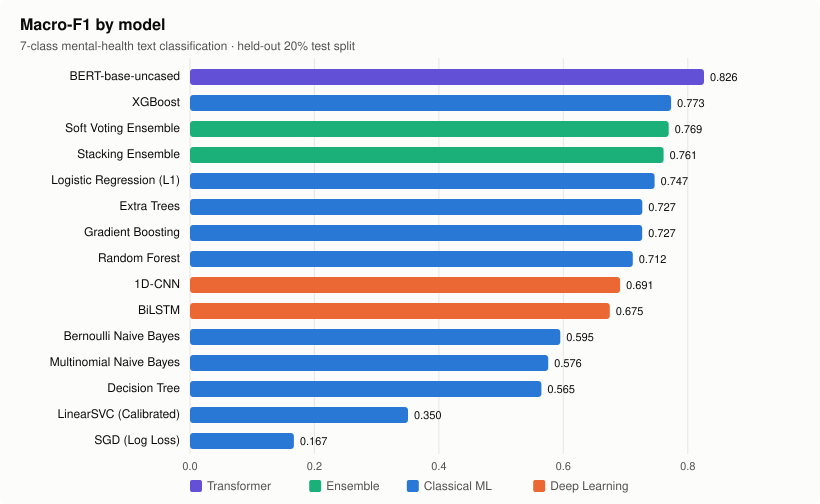
</p>

### 🔑 Key findings

1. **Transformers win clearly.** Fine-tuned BERT improves Macro-F1 by **+5.3 points** over the best classical model (XGBoost) and by **+13.5 points** over the best deep-learning baseline (1D-CNN).
2. **The gain is largest on the hardest minority classes.** Against XGBoost, BERT lifts F1 on *Stress* (0.67 → 0.76), *Personality disorder* (0.72 → 0.80) and *Anxiety* (0.82 → 0.89).
3. **Well-tuned TF-IDF baselines beat recurrent nets trained from scratch.** XGBoost and L1-Logistic Regression both outperform the 1D-CNN and BiLSTM, which overfit quickly (training accuracy ≈ 0.87 vs validation ≈ 0.75).
4. **Depression ↔ Suicidal is the dominant confusion** for every model family — the two classes share vocabulary (*"want", "life", "die", "anymore"*) and remain the main open challenge (BERT F1: 0.77 / 0.75).
5. **Ensembling adds little over the best single learner** here: soft voting and stacking land just below XGBoost.

<p align="center">
  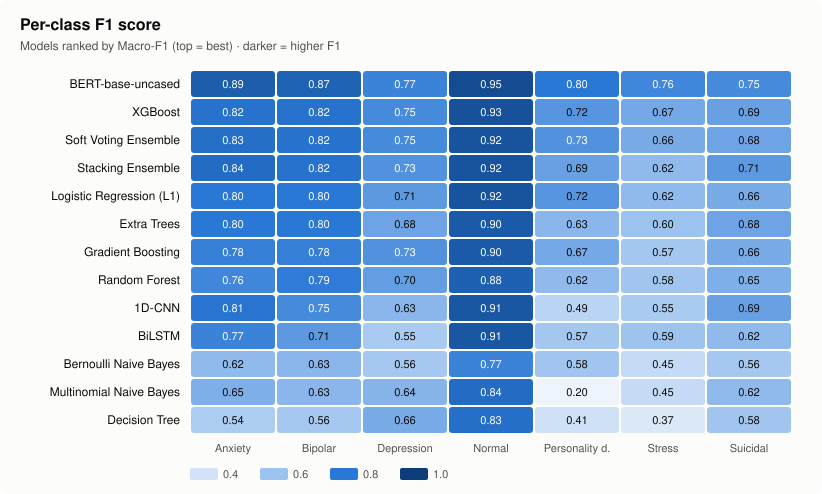
</p>

---

## 🔄 Pipeline

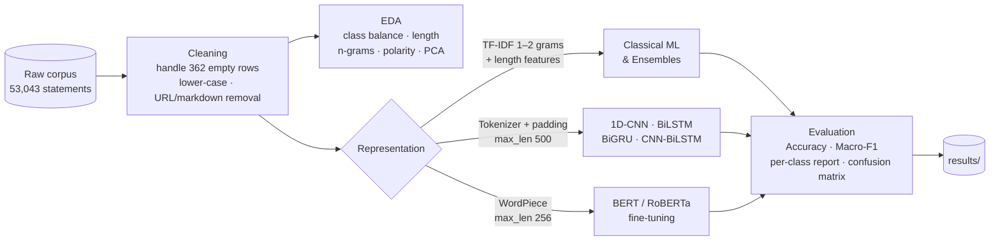

**Preprocessing highlights**

- **Stop words are deliberately kept** — negations and pronouns (*"not", "I", "never"*) carry sentiment in this domain.
- **Porter stemming** for the classical pipeline; transformers receive the cleaned raw text.
- **Class imbalance** handled with balanced class weights (deep learning and BERT) and class-weighted meta-learner (stacking).
- Full details: [`docs/methodology.md`](docs/methodology.md)

---

## 📊 Exploratory data analysis

| Class balance | Words per class |
|:---:|:---:|
| 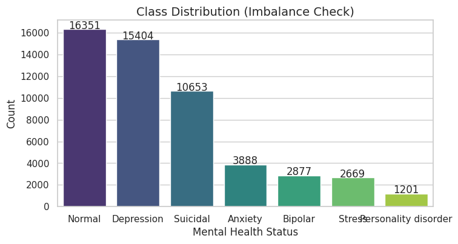 | 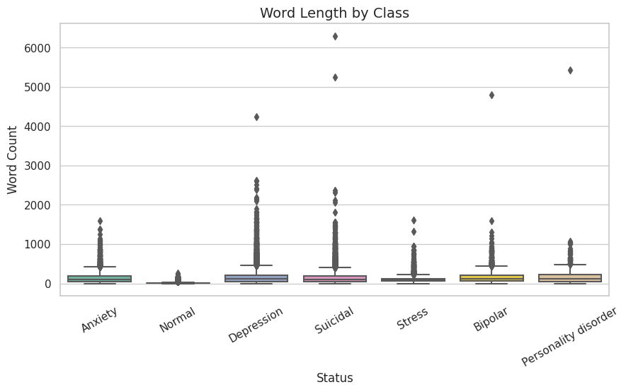 |
| **Lexical diversity** | **TF-IDF space (PCA, 2D)** |
| 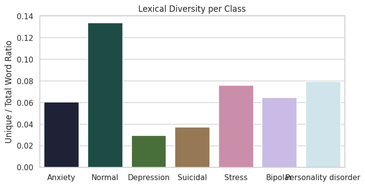 | 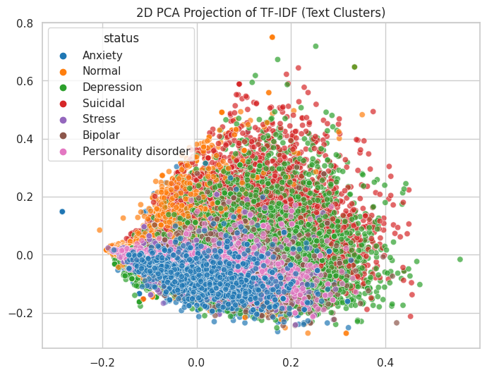 |

<details>
<summary><b>☁️ Word clouds for all seven classes</b></summary>
<br>
<p align="center">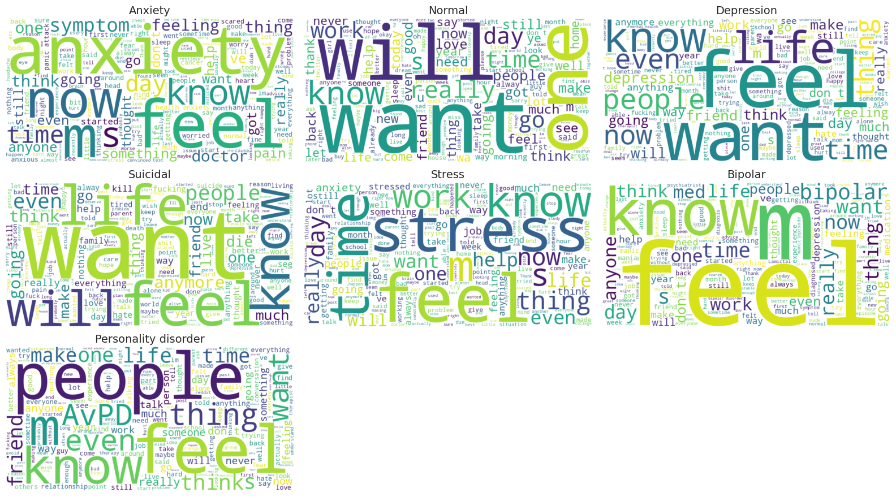</p>

Individual clouds: [`results/figures/wordclouds/`](results/figures/wordclouds)
</details>

<details>
<summary><b>More EDA figures</b> (n-grams, sentiment polarity, discriminative terms, text length)</summary>
<br>

| Top unigrams | Top bigrams |
|:---:|:---:|
| 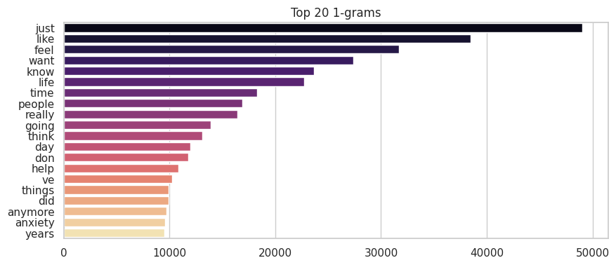 | 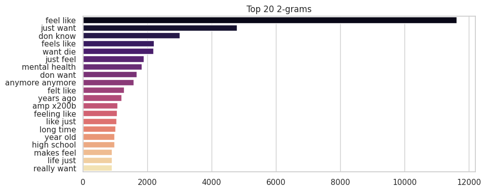 |
| **Sentiment polarity by class** | **Terms over-represented in *Suicidal* vs *Normal*** |
| 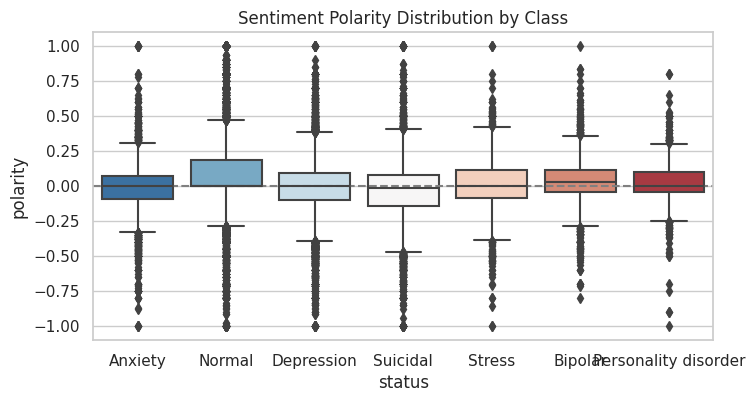 | 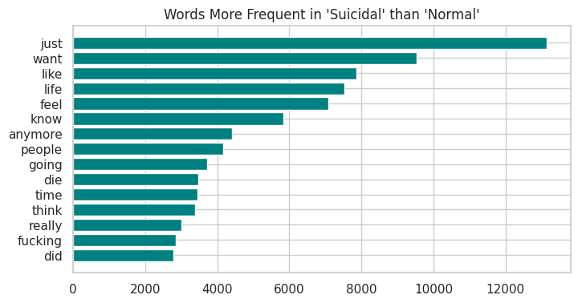 |

</details>

---

## 🧪 Model evaluation

<p align="center">
  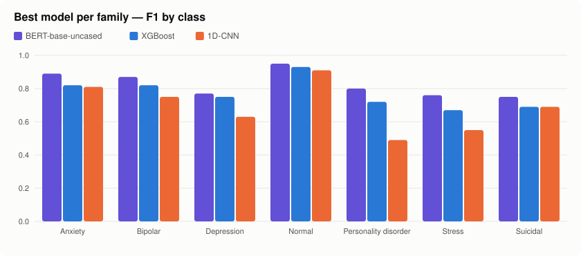
</p>

| BERT-base-uncased | XGBoost | 1D-CNN |
|:---:|:---:|:---:|
| 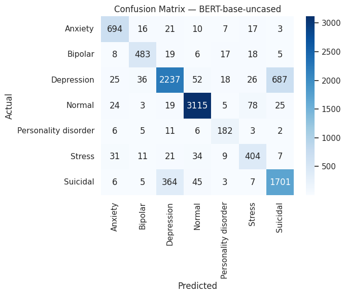 | 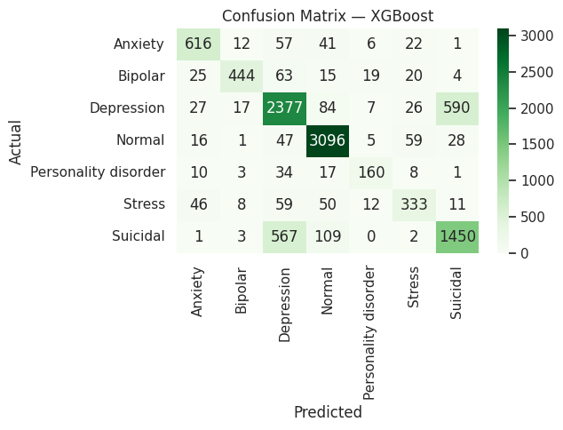 | 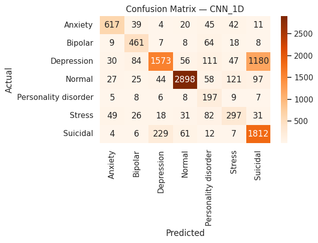 |

- 📁 All 15 confusion matrices → [`results/figures/confusion_matrices/`](results/figures/confusion_matrices)
- 📄 Per-model classification reports → [`results/classification_reports/`](results/classification_reports)
- 📈 Per-class precision / recall / F1 → [`results/metrics/per_class_precision_recall.csv`](results/metrics/per_class_precision_recall.csv)
- 📝 Written analysis & error analysis → [`docs/evaluation_summary.md`](docs/evaluation_summary.md)

---

## 🗂 Repository structure

```text
MSC_Project/
├── notebooks/
│   ├── 01_eda_classical_ml_deep_learning.ipynb   # EDA, preprocessing, 12 ML models + ensembles, CNN/BiLSTM/BiGRU
│   ├── 02_transformer_bert.ipynb                 # BERT-base-uncased & RoBERTa-base fine-tuning
│   └── archive/                                  # earlier notebook revision, kept for provenance
├── results/
│   ├── metrics/                                  # machine-readable scores (CSV)
│   │   ├── model_comparison.csv
│   │   ├── per_class_f1.csv
│   │   ├── per_class_precision_recall.csv
│   │   └── dataset_class_distribution.csv
│   ├── classification_reports/                   # sklearn classification report per model (15 × .txt)
│   └── figures/
│       ├── eda/                                  # exploratory analysis plots
│       ├── wordclouds/                           # one word cloud per class
│       ├── confusion_matrices/                   # 15 confusion matrices
│       └── model_comparison/                     # cross-model comparison charts
├── docs/
│   ├── methodology.md                            # data, preprocessing, models, hyper-parameters
│   └── evaluation_summary.md                     # findings, error analysis, limitations
├── requirements.txt
└── README.md
```

---

## ▶️ Reproducing the results

**1. Get the data** — the corpus is the public Kaggle dataset [*Sentiment Analysis for Mental Health*](https://www.kaggle.com/datasets/suchintikasarkar/sentiment-analysis-for-mental-health) (`Combined Data.csv`). It is not redistributed here; download it and update the `read_csv` path in each notebook.

**2. Install dependencies**

```bash
git clone https://github.com/smhasan24/MSC_Project.git
cd MSC_Project
pip install -r requirements.txt
python -m nltk.downloader punkt punkt_tab
```

**3. Run the notebooks in order**

| Notebook | Runtime used | Approx. time |
|---|---|---|
| `01_eda_classical_ml_deep_learning.ipynb` | Kaggle, 2 × NVIDIA T4 | ML models: minutes · BiLSTM/BiGRU: ~40–50 min per epoch |
| `02_transformer_bert.ipynb` | Google Colab GPU | BERT: 4 epochs |

> 💡 The deep-learning cell is slow because of `recurrent_dropout`, which disables the cuDNN kernel. Removing it speeds training up by an order of magnitude.

---

## ⚠️ Limitations & responsible use

- **Not a diagnostic tool.** Labels are inherited from the public datasets the corpus was compiled from (mostly social-media posts), not from clinical assessment. The models detect *linguistic patterns associated with* a label, not a person's mental state.
- **Test sets are close but not identical across notebooks** (10,609 vs 10,537 rows, because the BERT notebook drops nulls before a stratified split). Differences under ~1 point should not be over-interpreted.
- **Oversampling did not run** in the saved classical-ML run: `RandomOverSampler` was unavailable in that environment and the pipeline fell back to the original class distribution (logged in the notebook).
- **BiGRU, CNN-BiLSTM and RoBERTa** are implemented but their runs did not complete in the saved notebooks, so they are not reported.
- Single split, single seed — no confidence intervals yet. See [`docs/evaluation_summary.md`](docs/evaluation_summary.md#future-work).

If you or someone you know is struggling, please contact a local health service or, in the UK, call **Samaritans on 116 123**.

---

## 👤 Author

**S M Mahamudul Hasan** — MSc Artificial Intelligence and Robotics with Advanced Research, University of Hertfordshire

[](https://hasansm.com)
[](https://www.linkedin.com/in/sm-mahamudul-hasan)
[](https://github.com/smhasan24)

<sub>Dataset credit: Suchintika Sarkar, *Sentiment Analysis for Mental Health* (Kaggle), compiled from multiple public sources.</sub>
